# WorldSandboxPrototype 独立视觉复验证据（2026-10-15）

《神之沙盘》（WorldSandboxPrototype，Unity 6 + URP 2D，Tiny Swords 素材）**2026-10-15 独立视觉复验（制作人复检批）**的原始证据材料公开副本。

> 本仓库**只包含验证证据材料**，不包含任何游戏源码、Scene、Prefab、ScriptableObject、Packages 或 ProjectSettings。主游戏仓库保持私有，其内容不在本仓库中。

## 批次索引

本仓库按批次组织证据，各批次独立完整、互不修改：

| 批次 | 内容 | 目录 |
|---|---|---|
| ① 独立视觉复验（制作人复检批） | 39 张画面复验（A–H 八类）+ 3 份测试 XML | [evidence/independent-visual-verification-2026-10-15/](evidence/independent-visual-verification-2026-10-15) |
| ② **悬崖修复专项（新增）** | 修复前/后各 6 张 + v1 失败方案存档 6 张 + 专项联系表 + 4 份原始测试 XML | [evidence/cliff-repair-2026-10-15/](evidence/cliff-repair-2026-10-15) · [批次 README](evidence/cliff-repair-2026-10-15/README.md) |
| ③ **地图视觉重构 MVO（新增）** | 修复前基线 + 一轮/终版对照 + 3 种子全图 + 云树同框 + 官方×基线×终版联系表 + 272 文件哈希清单 + 30 份原始测试 XML（EditMode 211/211、PlayMode 60/60 终态） | [evidence/map-visual-overhaul-2026-10-15/](evidence/map-visual-overhaul-2026-10-15) · [批次 README](evidence/map-visual-overhaul-2026-10-15/README.md) |
| ④ **基础地图地形结构（新增）** | 三种子全图 + 12 类地形局部（崖壁/台阶/坡面/阴影/顶面/净空）+ 3 manifest + 29 份原始测试 XML（EditMode 220/220、PlayMode 63/63 终态）+ 107 项哈希清单 | [evidence/terrain-structure-2026-10-16/](evidence/terrain-structure-2026-10-16) · [批次 README](evidence/terrain-structure-2026-10-16/README.md) |

> 下方"批次摘要 / 三类画面 / 分类导览"描述的是**批次①（独立视觉复验）**；批次②（悬崖修复专项）的完整导览、同条件对照设计与"能证明/不能证明"边界见其[批次 README](evidence/cliff-repair-2026-10-15/README.md)。
> 批次③（地图视觉重构 MVO）以 `after/MVO1a-fullmap-overview-ortho40.png` 为完整地图主对照图，官方×基线×终版×多种子对照见其 [联系表](evidence/map-visual-overhaul-2026-10-15/contact-sheet-mvo.svg)；完整导览、迭代史与逐张"能证明/不能证明"边界见其[批次 README](evidence/map-visual-overhaul-2026-10-15/README.md)。
> 批次④（基础地图地形结构）以 `seed-20261013/TS1a-fullmap-ortho40.png` 为完整地图主对照图（另有 ortho64 满幅与三种子对照）；三级高程架构、12 类局部导览与逐张"能证明/不能证明"边界见其[批次 README](evidence/terrain-structure-2026-10-16/README.md)。

## 批次摘要

| 项 | 值 |
|---|---|
| 证据生成日期 | 2026-10-15 |
| 批次目录 | [`evidence/independent-visual-verification-2026-10-15/`](evidence/independent-visual-verification-2026-10-15) |
| 原始 PNG | **39 张**（A–H 八类，分类存放于 `images/`） |
| 附加材料 | `overview.png`（总览拼图 1280×1440）、`capture-manifest.md`（捕获清单）、`results.md`（复验结果）、`test-results/`（3 份原始测试 XML） |
| 捕获场景 | `Assets/_Project/Scenes/Main.unity`（生产场景，真实工作区代码/资源） |
| 地图种子 | 20261013（GameBootstrap 默认） |
| 分辨率 | 1280×720（GameView） |
| 运行方式 | Unity 6000.6.5f1 batchmode + 显卡；由 PlayMode 测试驱动真实运行与捕获 |

## 三类画面如何区分（阅读证据前请先读）

| 类型 | 特征 | 本批情况 |
|---|---|---|
| **真实 GameView 画面（GameView ScreenCapture）** | 含完整游戏内 UI：顶栏（资源计数、"第X年X天"、暂停钮）、底部工具/事件栏，为玩家视角的实际游戏画面 | **本批 39 张全部属于此类** |
| PlayMode ScreenCapture（本批实际采用方式） | 由 PlayMode 测试在真实运行中调用屏幕捕获；捕获前执行 `cam.Render()` 强制渲染一帧，避免 GPU 合成滞后导致抓到旧帧（详见捕获清单"捕获环境与可靠性"） | 39 张均以该方式截取 |
| 独立相机直渲染帧（Camera RenderTexture / `cam.Render`+`ReadPixels`，辅助轨） | 由相机直接渲染输出：**不含游戏 UI 叠加层**，属于"相机直出帧"，不等同于玩家所见画面 | 捕获清单提及的辅助轨 `cam-*.png` 属于此类；**该辅助轨文件不在本批证据目录中，未包含在本次发布** |

点击任意 PNG 文件名即可在 GitHub 网页中查看原始截图（无损 PNG，未经重绘或压缩替换）。

## 分类导览

### 总览

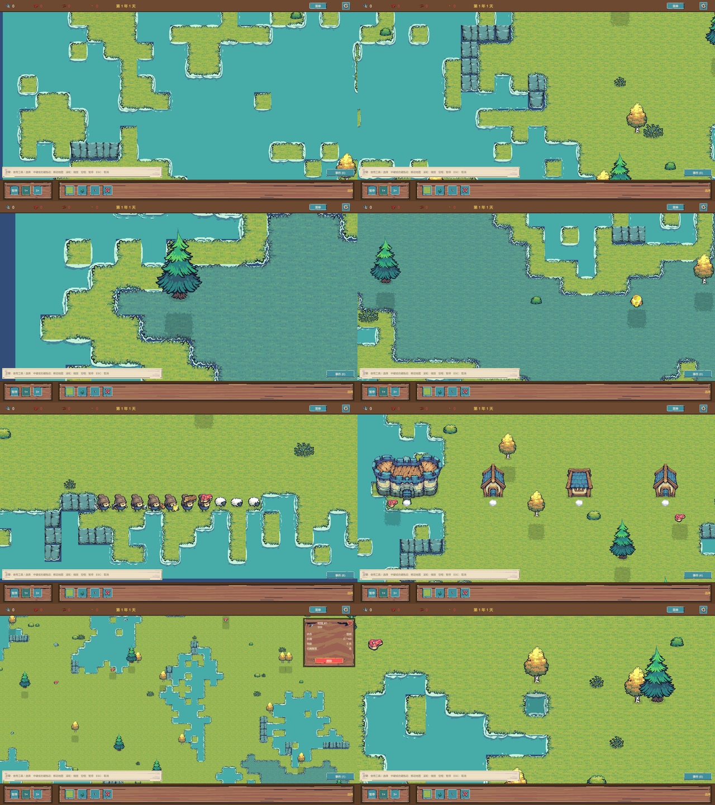

[overview.png](evidence/independent-visual-verification-2026-10-15/overview.png) — 39 张截图总览拼图（1280×1440）

### A. 泡沫形态 / 遮挡 / 动画（6 张）

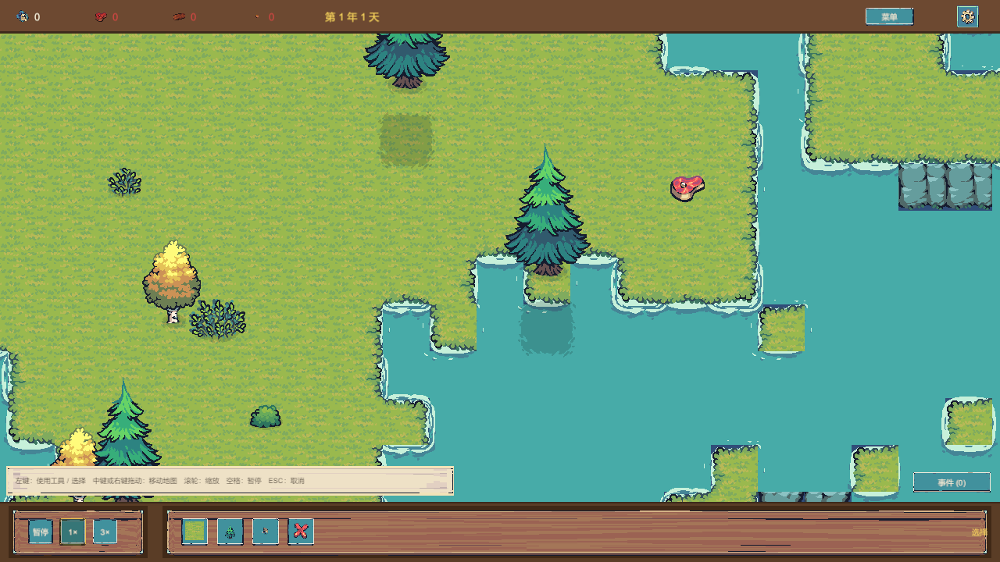

- 验证项：岸线泡沫贴边遮挡、凹角/窄水道/小岛泡沫、草林交界、泡沫动画帧变化（10fps 错相，三帧）
- 结论：**通过** —— 贴岸细边、无圆角方块/断线/穿透；A2 为关键证据（窄条与小岛泡沫正常，是撤销误判修改的依据）
- 图片：[A1](evidence/independent-visual-verification-2026-10-15/images/A-foam/A1-coast-foam-occlusion.png) · [A2](evidence/independent-visual-verification-2026-10-15/images/A-foam/A2-narrow-water-corner.png) · [A3](evidence/independent-visual-verification-2026-10-15/images/A-foam/A3-grass-forest-edge.png) · [A4-t0](evidence/independent-visual-verification-2026-10-15/images/A-foam/A4-foam-anim-t0.png) · [A4-t1](evidence/independent-visual-verification-2026-10-15/images/A-foam/A4-foam-anim-t1.png) · [A4-t2](evidence/independent-visual-verification-2026-10-15/images/A-foam/A4-foam-anim-t2.png)
- 目录：[images/A-foam](evidence/independent-visual-verification-2026-10-15/images/A-foam)

### B. 悬崖 / 高地 / 阴影（3 张）

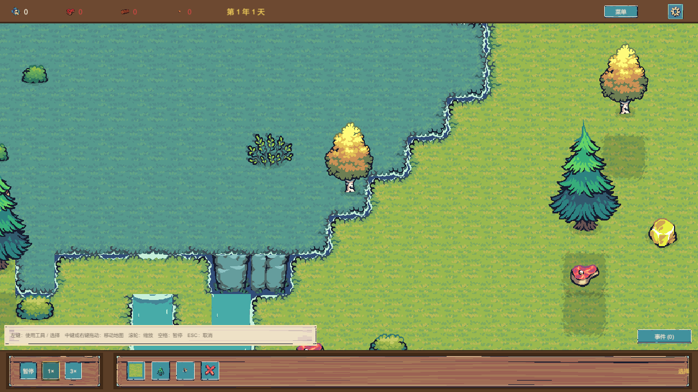

- 验证项：崖带连接与层级、沿岸崖段、树影落地/被高地遮挡/不穿崖
- 结论：**通过** —— 崖带连接自然；影在树根南侧、不穿崖
- 图片：[B1](evidence/independent-visual-verification-2026-10-15/images/B-terrain-shadow/B1-cliff-band-connection.png) · [B2](evidence/independent-visual-verification-2026-10-15/images/B-terrain-shadow/B2-cliff-along-shore.png) · [B3](evidence/independent-visual-verification-2026-10-15/images/B-terrain-shadow/B3-tree-shadow-cliff-overlap.png)
- 目录：[images/B-terrain-shadow](evidence/independent-visual-verification-2026-10-15/images/B-terrain-shadow)

### C. 树木 / 树桩 / 灌木 / 岩石（8 张）

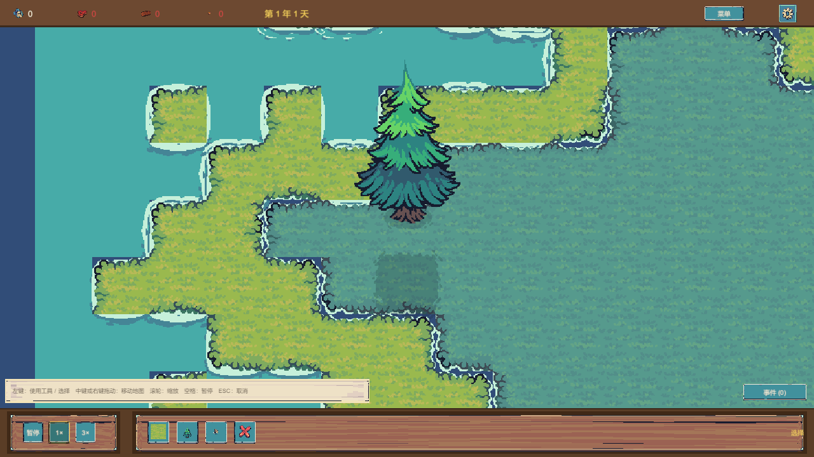

- 验证项：全树种变体根落地/树冠/遮挡（4 变体）、南北双树前后遮挡、耗尽转树桩位置不跳变、灌木与岩石比例/遮挡
- 结论：**通过** —— 南遮北；树桩在原树位、接地；装饰自然
- 图片：[C1-v0](evidence/independent-visual-verification-2026-10-15/images/C-trees-decorations/C1-tree-variant0.png) · [C1-v1](evidence/independent-visual-verification-2026-10-15/images/C-trees-decorations/C1-tree-variant1.png) · [C1-v2](evidence/independent-visual-verification-2026-10-15/images/C-trees-decorations/C1-tree-variant2.png) · [C1-v3](evidence/independent-visual-verification-2026-10-15/images/C-trees-decorations/C1-tree-variant3.png) · [C2](evidence/independent-visual-verification-2026-10-15/images/C-trees-decorations/C2-tree-overlap-north-south.png) · [C3](evidence/independent-visual-verification-2026-10-15/images/C-trees-decorations/C3-tree-stump-exhausted.png) · [C4-灌木岩石](evidence/independent-visual-verification-2026-10-15/images/C-trees-decorations/C4-bush-groundrock.png) · [C4-金矿](evidence/independent-visual-verification-2026-10-15/images/C-trees-decorations/C4-goldstone.png)
- 目录：[images/C-trees-decorations](evidence/independent-visual-verification-2026-10-15/images/C-trees-decorations)

### D. 水岩 / 鸭 / 云（3 张）

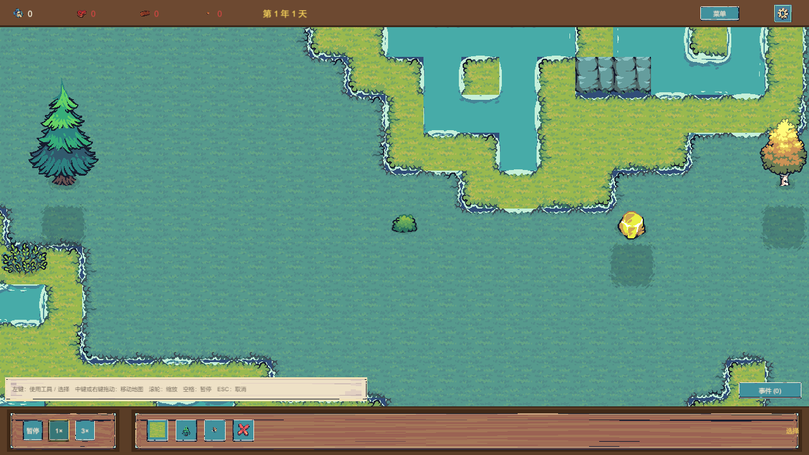

- 验证项：水岩露出比例、鸭尺寸位置、云层级与移动
- 结论：**部分通过** —— 装饰正确；云帧间位移可测，但全图视野内云稀少（云在高位带，取景覆盖有限）
- 图片：[D1D2](evidence/independent-visual-verification-2026-10-15/images/D-water-decorations/D1D2-waterrocks-duck-decorations.png) · [D3-t0](evidence/independent-visual-verification-2026-10-15/images/D-water-decorations/D3-clouds-t0.png) · [D3-t1](evidence/independent-visual-verification-2026-10-15/images/D-water-decorations/D3-clouds-t1.png)
- 目录：[images/D-water-decorations](evidence/independent-visual-verification-2026-10-15/images/D-water-decorations)

### E. 人物 / 羊 / 动画（6 张）

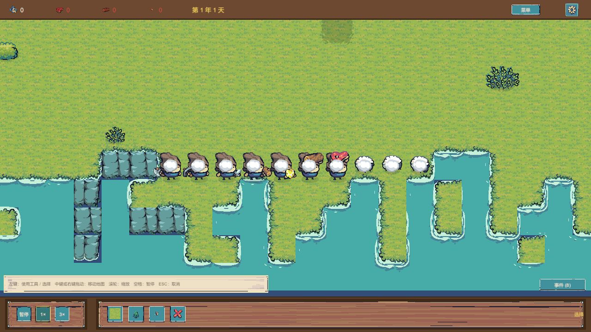
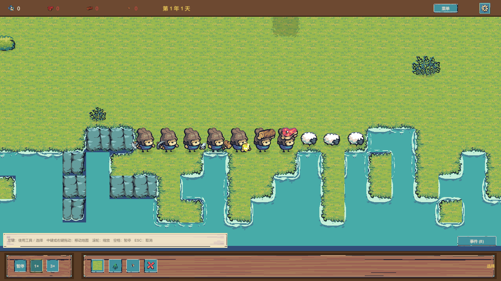

- 验证项：落地尘特效（SpawnCreature 事件链）、全工具变体+接地+遮挡、变体细节、动画帧序推进、Work 状态切换
- 结论：**通过**（修复 1 处位置 bug） —— 7 变体+3 羊全辨；"白棉球"现象经查为 Dust 落地特效而非泡沫回归（E0 尘团 vs E1 尘散后干净画面，两图对照）
- 图片：[E0](evidence/independent-visual-verification-2026-10-15/images/E-creatures/E0-spawn-dust-fx.png) · [E1](evidence/independent-visual-verification-2026-10-15/images/E-creatures/E1-creatures-all-variants-wide.png) · [E2](evidence/independent-visual-verification-2026-10-15/images/E-creatures/E2-creatures-closeup.png) · [E3-t0](evidence/independent-visual-verification-2026-10-15/images/E-creatures/E3-idle-anim-t0.png) · [E3-t1](evidence/independent-visual-verification-2026-10-15/images/E-creatures/E3-idle-anim-t1.png) · [E4](evidence/independent-visual-verification-2026-10-15/images/E-creatures/E4-axe-work-state.png)
- 目录：[images/E-creatures](evidence/independent-visual-verification-2026-10-15/images/E-creatures)
- ⚠️ E2 与 E3-t0 为字节级相同文件，详见 [VERIFICATION-NOTES.md](VERIFICATION-NOTES.md)

### F. 建筑 / 特效（3 张）

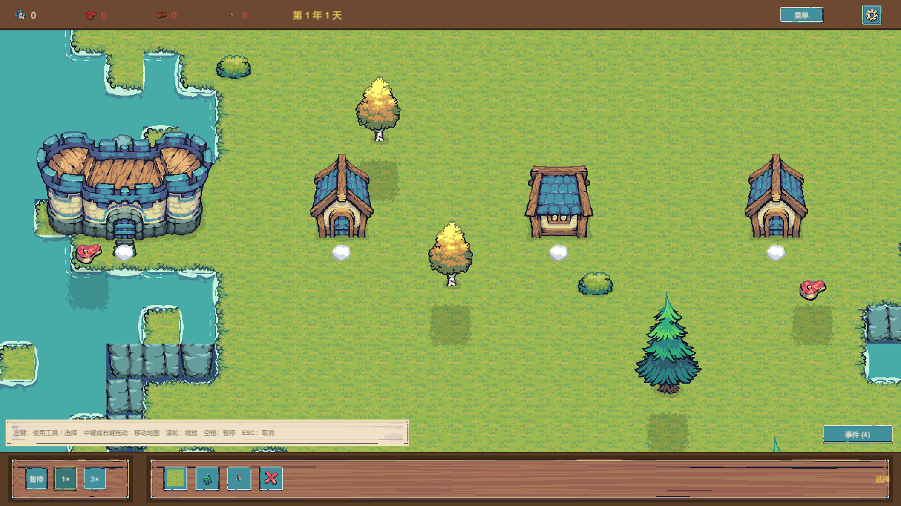

- 验证项：Castle+House 变体/占地/遮挡、RemoveAt→Explosion+Fire 真实事件链、水域拒绝反馈→Splash
- 结论：**通过** —— 特效为真实事件链触发+生命周期（F3 语义=命令拒绝反馈，非落水）
- 图片：[F1](evidence/independent-visual-verification-2026-10-15/images/F-buildings-fx/F1-buildings-castle-houses.png) · [F2](evidence/independent-visual-verification-2026-10-15/images/F-buildings-fx/F2-explosion-fire-remove.png) · [F3](evidence/independent-visual-verification-2026-10-15/images/F-buildings-fx/F3-water-splash-reject.png)
- 目录：[images/F-buildings-fx](evidence/independent-visual-verification-2026-10-15/images/F-buildings-fx)

### G. UI / 色板（5 张）

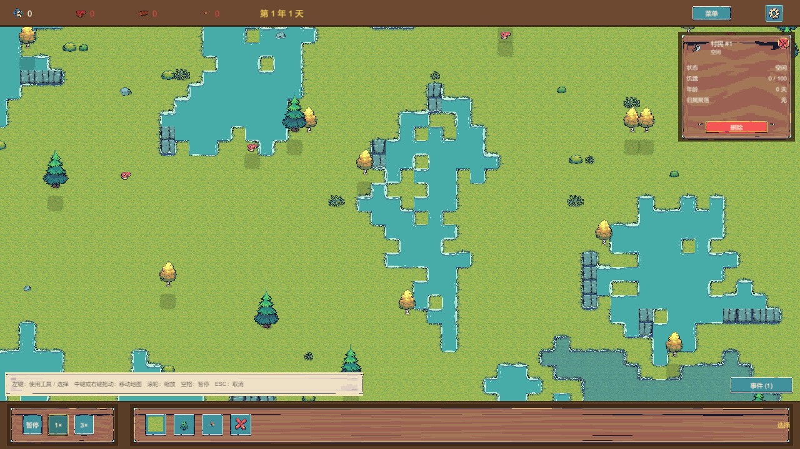

- 验证项：HUD/详情卡/按钮/图标、地形色板 4 色调、九槽自洽
- 结论：**通过** —— 四色可辨、九槽自洽
- 图片：[G1](evidence/independent-visual-verification-2026-10-15/images/G-ui-palettes/G1-hud-detailcard-gameview.png) · [G2](evidence/independent-visual-verification-2026-10-15/images/G-ui-palettes/G2-palette-color1.png) · [G3](evidence/independent-visual-verification-2026-10-15/images/G-ui-palettes/G3-palette-color2.png) · [G4](evidence/independent-visual-verification-2026-10-15/images/G-ui-palettes/G4-palette-color3.png) · [G5](evidence/independent-visual-verification-2026-10-15/images/G-ui-palettes/G5-palette-color4.png)
- 目录：[images/G-ui-palettes](evidence/independent-visual-verification-2026-10-15/images/G-ui-palettes)

### H. 工具交互（5 张）

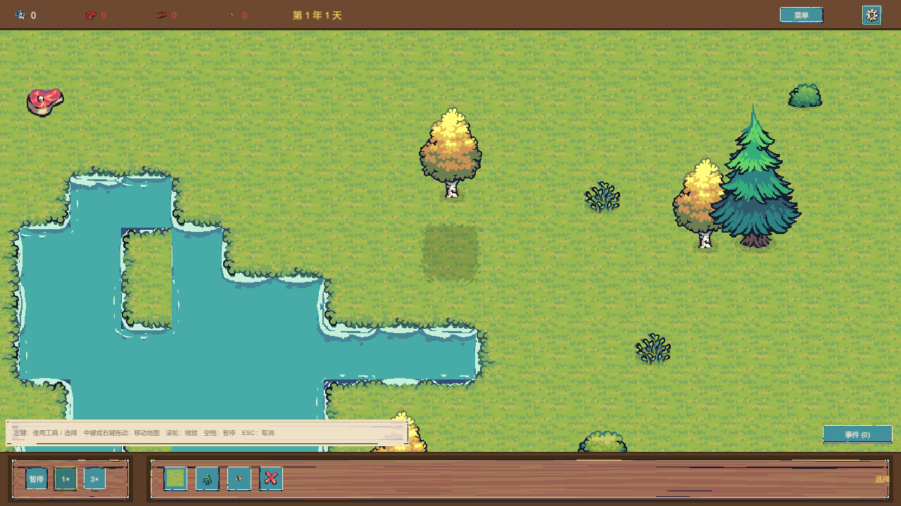
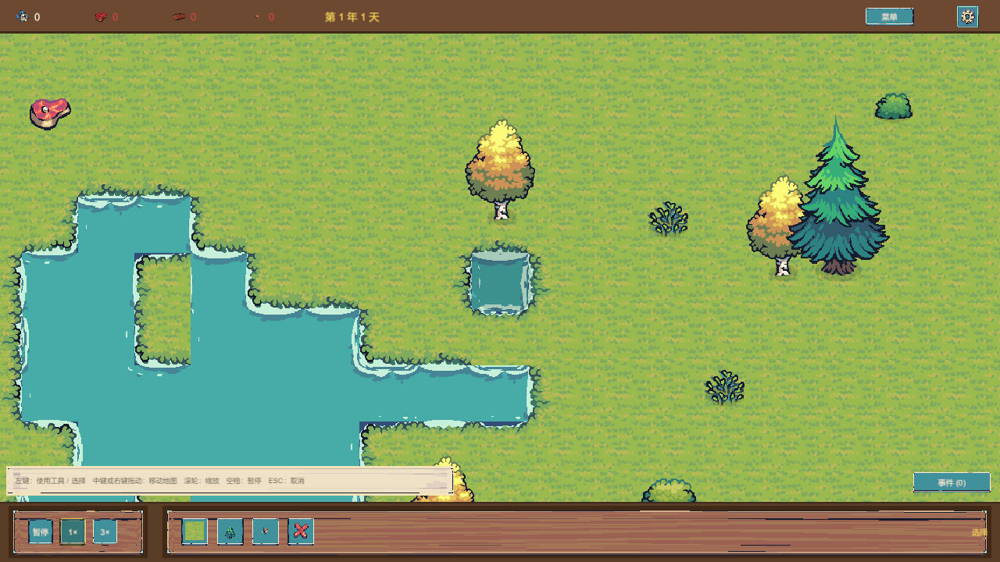

- 验证项：PaintTerrain 真实数据+渲染（草→水前后对照）、PlaceResource 真实写入、RemoveAt 真实移除
- 结论：**通过**（本轮实现真实命令，替代原占位） —— 前后对照 + 数据断言（世界数据真实改变+画面刷新）
- 图片：[H1-前](evidence/independent-visual-verification-2026-10-15/images/H-tool-interactions/H1-paint-before-grass.png) · [H1-后](evidence/independent-visual-verification-2026-10-15/images/H-tool-interactions/H1-paint-after-water.png) · [H2-前](evidence/independent-visual-verification-2026-10-15/images/H-tool-interactions/H2-placeres-before.png) · [H2-后](evidence/independent-visual-verification-2026-10-15/images/H-tool-interactions/H2-placeres-after-tree.png) · [H3](evidence/independent-visual-verification-2026-10-15/images/H-tool-interactions/H3-removeat-after.png)
- 目录：[images/H-tool-interactions](evidence/independent-visual-verification-2026-10-15/images/H-tool-interactions)

## 文件导航

- 捕获清单（39 张逐张对应验证项与结论）：[capture-manifest.md](evidence/independent-visual-verification-2026-10-15/capture-manifest.md)
- 复验结果（八类结论总表、修复记录、测试结果）：[results.md](evidence/independent-visual-verification-2026-10-15/results.md)
- 原始测试 XML：[test-results/](evidence/independent-visual-verification-2026-10-15/test-results)（final5-em.xml / final5-pm.xml / vv-pm7.xml）
- 发布前核查说明与已知问题：[VERIFICATION-NOTES.md](VERIFICATION-NOTES.md)
- 全部文件哈希清单（sha256sum 格式）：[SHA256SUMS.txt](SHA256SUMS.txt)
- **悬崖修复专项（批次②，2026-10-15 新增）**：[批次 README](evidence/cliff-repair-2026-10-15/README.md)（含证明力边界与测试基线声明） · [捕获清单](evidence/cliff-repair-2026-10-15/capture-manifest.md) · [专项联系表](evidence/cliff-repair-2026-10-15/cliff-contact-sheet.svg) · [测试结果](evidence/cliff-repair-2026-10-15/test-results) · [v1 失败方案存档说明](evidence/cliff-repair-2026-10-15/iteration-v1-rejected/NOTES.md)

### 原始文件访问方式

- 在 GitHub 网页中点击任意图片文件名即可预览原始 PNG；分类目录见上方各类链接。
- raw 直链模式：`https://raw.githubusercontent.com/Lucifer-zql/WorldSandboxPrototype-visual-evidence/main/<仓库内路径>`
  （示例：`.../main/evidence/independent-visual-verification-2026-10-15/images/A-foam/A2-narrow-water-corner.png`）
- 克隆仓库后可用 `sha256sum -c SHA256SUMS.txt` 校验全部证据文件完整性。

## 口径与免责

- `results.md` 中的测试结果为**执行方（AI 执行 + 本地真实运行）记录的测试结果，不代表所有视觉问题已经由外部审查者签核**。
- 发布前核查发现的事项（E2/E3-t0 字节重复、results.md 汇总计数与原始 XML 的差异、`cam-*.png` 辅助轨缺失）已如实记录于 [VERIFICATION-NOTES.md](VERIFICATION-NOTES.md)；全部原始文件按原样保留、未删改。
- 本仓库证据不含主项目源码；如需对照实现请以主游戏仓库为准。
