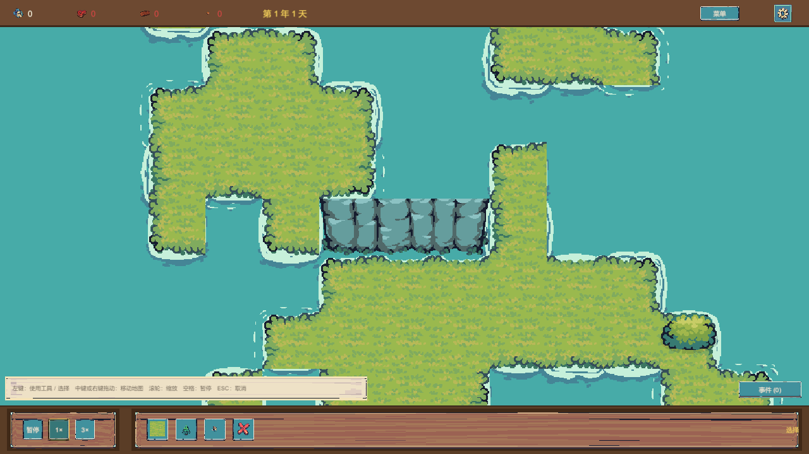
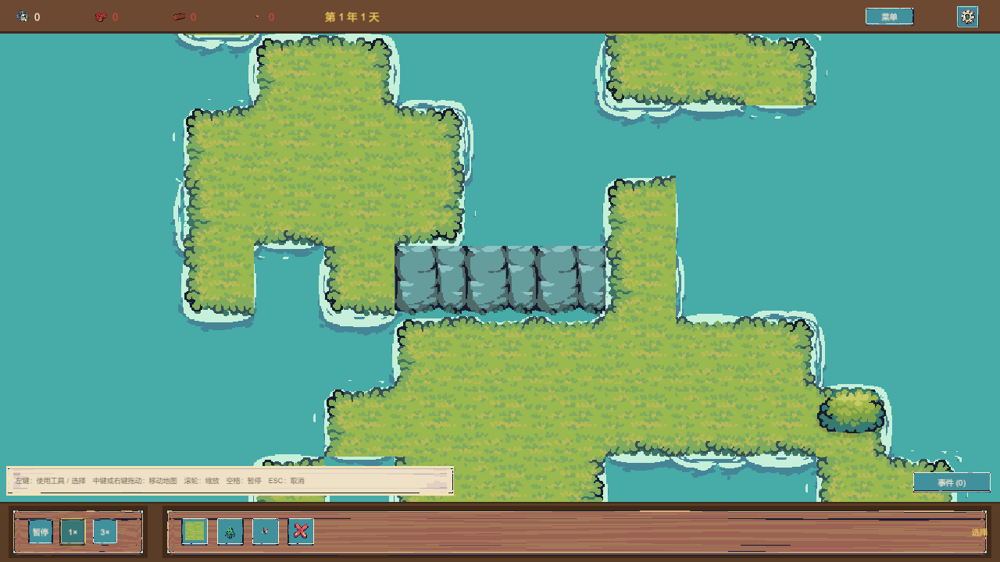

# 悬崖修复专项证据（2026-10-15）

《神之沙盘》（WorldSandboxPrototype，Unity 6 + URP 2D，Tiny Swords 素材）**悬崖渲染修复（AI-A 第二轮攻坚）**的原始证据材料公开副本。

> 本批次只包含验证证据材料，不包含任何游戏源码、Scene、Prefab、ScriptableObject、Packages 或 ProjectSettings。主游戏仓库保持私有，其内容不在本仓库中。

## 批次摘要

| 项 | 值 |
|---|---|
| 证据生成日期 | 2026-10-15（本地 17:53–18:12 / UTC 09:53–10:12） |
| 批次目录 | `evidence/cliff-repair-2026-10-15/` |
| 修复前截图 | **6 张**（`cliff-before/`，旧 RT_Cliff 随机选片行为） |
| 修复后截图 | **6 张**（`cliff-after/`，v2 段锚方案——最终通过版本） |
| 迭代失败证据 | **6 张**（`iteration-v1-rejected/`，**已否定的 v1 环序方案**，与最终结果严格隔离） |
| 附加材料 | `cliff-contact-sheet.svg`（专项对照联系表）、`capture-manifest.md`（捕获清单）、`SHA256SUMS.txt`（哈希清单）、`test-results/`（4 份原始测试 XML） |
| 捕获场景 | `Assets/_Project/Scenes/Main.unity`（真实生产场景） |
| 地图种子 | 20261013（GameBootstrap 默认） |
| 分辨率 | 1280×720（GameView"HD"档位，Screen 实测 `1280x720`） |
| 运行方式 | Unity 6000.6.5f1，PlayMode 测试窗口化真实运行；由 `CliffAuditCaptureTests` 驱动捕获 |

## 测试基线声明（务必先读）

- 主游戏仓库本轮修复**未提交**：捕获时主仓库 HEAD 为 `47d8185`，该 HEAD **不包含**本轮悬崖修复代码。
- 本批全部截图与测试结果来自**当时未提交的工作区代码**（含 8 个切片 Tile 资产、`TerrainTilemapRenderer` 选片规则、`Main.unity` 接线、专项测试）。
- 请勿将本批证据解读为"`47d8185` 提交版本的行为"；它反映的是 2026-10-15 当日工作区（修复中版本）的实际运行画面。

## v1 / v2 方案的区分（最终结果 = v2）

| 方案 | 机制 | 状态 | 证据位置 |
|---|---|---|---|
| **v2 段锚选片（最终）** | 同段同片：横向段向左、纵向段向下扫描至段首，片序 = `(锚x+锚y) mod 4`（`Cliff_Land_41..44` / `Cliff_Water_50..53` 按底脚邻接分组） | **通过**（柱形统一、缝等宽，与官方柱列观感一致） | `cliff-after/`、`cliff-contact-sheet.svg` |
| v1 相位环序（已否定） | 组内按 `(x+y) mod 4` 连续取片 | **失败**：真实画面显示柱形格间跳变错位 | `iteration-v1-rejected/`（**独立目录，明确标注失败方案**） |

最终通过结果**仅**来自 v2 段锚方案。`iteration-v1-rejected/` 内的 6 张图是 v1 实现当时的捕获（17:54），仅用于解释"为何第二轮改为段锚选片"，**不得与最终结果混淆**。

## 同条件前后对照设计

- **唯一变量 = 悬崖选片规则**。其余全部相同：同一地图种子（20261013）、同一相机机位、同一分辨率（1280×720）、同一 GameView 档位。
- 修复前（before）= 反射清空 `cliffLandTiles/cliffWaterTiles` 数组 → 渲染器回退 `RT_Cliff` 旧行为（4 片随机取片）；
- 修复后（after）= 恢复 8 资产注入 → 底脚按邻接分组 + 段锚统一选片。
- 两轮捕获的定位坐标完全一致（水平段 (5,5) / 垂直段 (55,10) / 转角 (123,18) / 水脚 (67,4) / 陆脚 (68,4)），可逐像素对照。

## 分类导览

### 修复前（`cliff-before/`，6 张）

- 水平段（相机 ortho=4，中心格 (5,5)）：旧随机选片下**柱形/缝宽随格跳变**。
- 图片：[C1](cliff-before/C1-horizontal-run.png) · [C2](cliff-before/C2-vertical-run.png) · [C3](cliff-before/C3-corner.png) · [C4](cliff-before/C4-water-foot.png) · [C5](cliff-before/C5-land-foot.png) · [C6](cliff-before/C6-overview.png)

### 修复后 v2（`cliff-after/`，6 张）

- 水平段：**同段同片，柱形统一、缝等宽**（与 before 同机位逐像素对照）。
- 垂直段：全段同片、柱脚按邻接选择（最下格接水 → 水线脚）。
- L 形转角：横臂/竖臂均正确解析，转角无错片。
- 水脚 / 陆脚：C4（下邻=水 → `_50.._53` 水线柱脚）与 C5（下邻=草 → `_41.._44` 暗收边柱脚）对照可核对底脚分组生效。
- 全景：ortho=40，观察崖带整体分布与构图。
- 图片：[C1](cliff-after/C1-horizontal-run.png) · [C2](cliff-after/C2-vertical-run.png) · [C3](cliff-after/C3-corner.png) · [C4](cliff-after/C4-water-foot.png) · [C5](cliff-after/C5-land-foot.png) · [C6](cliff-after/C6-overview.png)

### 专项联系表

- [cliff-contact-sheet.svg](cliff-contact-sheet.svg) — 自包含（base64 内嵌）对照表：① 水平段 before/v2 放大对比 ② 垂直段 ③ 转角 ④ 水脚/陆脚 ⑤ Tiny Swords 原始切片参照条（`Tilemap_color1` 的 `_41.._44` 陆脚版 / `_50.._53` 水脚版）。
- [cliff-contact-sheet-preview.png](cliff-contact-sheet-preview.png) — 上述 SVG 的 PNG 渲染预览（1400×3360，Chrome 固定视口离屏渲染生成，便于在不能渲染 SVG 的环境查看；内容与 SVG 相同，未对游戏截图做任何美化/重绘）。
- 在 GitHub 中点击文件名可预览；下载后用浏览器打开可查看完整版式。

### 原始测试结果（`test-results/`）

| 文件 | 内容 | 结果 |
|---|---|---|
| `cliff-before2.xml` | 修复前专项捕获（`CliffAuditCaptureTests`，6 用例；mode=legacy） | **6/6 通过** |
| `cliff-after2.xml` | 修复后 v2 专项捕获（同 6 用例；mode=phase8） | **6/6 通过** |
| `editmode-final.xml` | 最终全量 EditMode 回归（含 `CliffTileSelectionTests` 9 用例 + 全部既有测试） | **199/199 通过** |
| `playmode-final2.xml` | 最终全量 PlayMode 回归 | **55/55 通过** |

## 每张图片能证明什么 / 不能证明什么

**修复前（`cliff-before/`）**

| 图片 | 能证明 | 不能证明 |
|---|---|---|
| C1-horizontal-run | 种子 20261013 该水平崖段在旧 RT_Cliff 随机选片下柱形/缝宽随格跳变（缺陷存在） | 其他种子、其他崖段的全部排列 |
| C2-vertical-run | 该垂直崖段旧行为的拼接状态 | 其他方向崖段 |
| C3-corner | 该 L 形转角旧行为的拼接状态 | 所有可能的转角组合 |
| C4-water-foot / C5-land-foot | 该两格崖格旧行为下的柱脚（未按邻接分组） | 全图水脚/陆脚的普遍性 |
| C6-overview | 修复前全景构图与崖带分布 | 局部细节（需看 C1–C5） |

**修复后（`cliff-after/`）**

| 图片 | 能证明 | 不能证明 |
|---|---|---|
| C1-horizontal-run | 与 before 同机位下，v2 该水平段柱形统一、缝等宽（修复生效的直接画面证据） | 其他种子/其他崖段（由 EditMode 多种子冒烟测试与规则测试补充覆盖） |
| C2-vertical-run | 该垂直段全段同片、柱脚按邻接解析 | 全图垂直段普遍性 |
| C3-corner | 该 L 形转角无错片 | 全部转角拓扑 |
| C4-water-foot | 该水脚格使用水脚版切片（柱脚水线） | 画面中逐格核验全部水脚格（抽查证据） |
| C5-land-foot | 该陆脚格使用陆脚版切片（柱脚暗收边） | 同上 |
| C6-overview | 修复后全景构图与崖带整体分布 | 局部细节 |

**关于"证明力边界"的说明（如实登记）**

- 截图为**抽点证据**：证明"在种子 20261013 的地图、上述 5 个确定性定位点上，修复前后确有可见差异且修复后形态符合素材规则"；不构成"所有种子、所有地图的每一段悬崖均已无条件正确"的证明——后者的覆盖面由 `test-results/editmode-final.xml` 中的 `CliffTileSelectionTests`（资产映射、底脚分组、段锚一致性、水平/垂直/拐角/边界/多种子全图冒烟）承担，两者互不替代。
- 截图为 1280×720 静态帧；柱脚水线/暗收边等细节较小，需结合联系表放大裁剪查看（联系表内为原图裁剪放大，未重绘内容）。
- 本批不包含动画验证（悬崖为静态地形，无动画）。

## 文件导航

- 捕获环境、命令、定位坐标与逐张说明：[capture-manifest.md](capture-manifest.md)
- v1 失败方案说明：[iteration-v1-rejected/NOTES.md](iteration-v1-rejected/NOTES.md)
- 本批哈希清单：[SHA256SUMS.txt](SHA256SUMS.txt)（`sha256sum -c` 可校验；仓库根另有全仓库汇总清单）

### 原始文件访问方式

- GitHub 网页中点击任意图片文件名即可预览原始 PNG（无损，未重绘/美化）。
- raw 直链模式：`https://raw.githubusercontent.com/Lucifer-zql/WorldSandboxPrototype-visual-evidence/main/evidence/cliff-repair-2026-10-15/<文件路径>`

## 口径与免责

- 本批证据为**执行方（AI 执行 + 本地真实运行）记录的验证材料**，不代表外部审查者已签核。
- 截图均来自真实运行捕获（PlayMode 测试驱动、GameView ScreenCapture），未经重绘、美化或替换；未提交的修复代码基线见上文"测试基线声明"。
- 相关实现细节（素材映射、邻接规则、测试）以主游戏仓库为准；本仓库不含源码。
