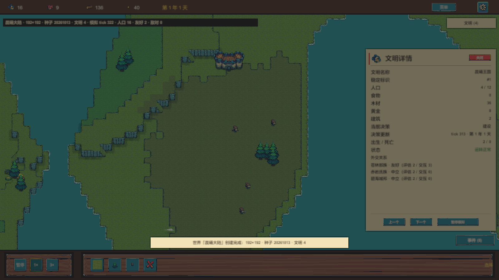
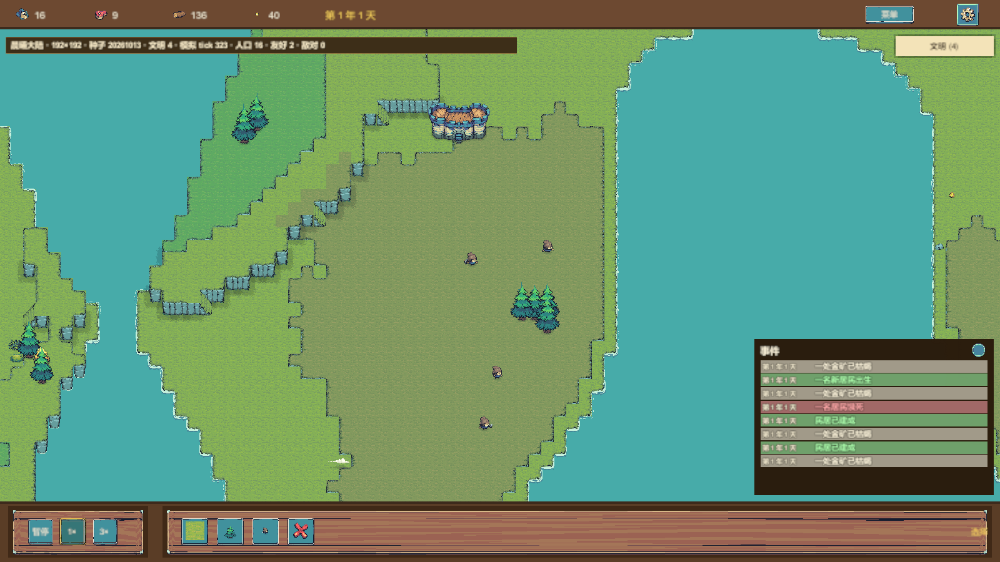
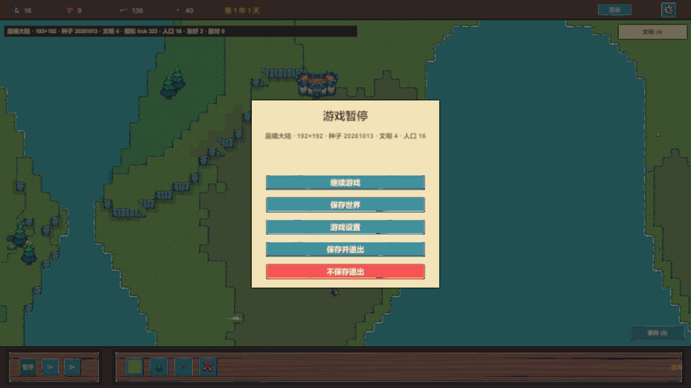
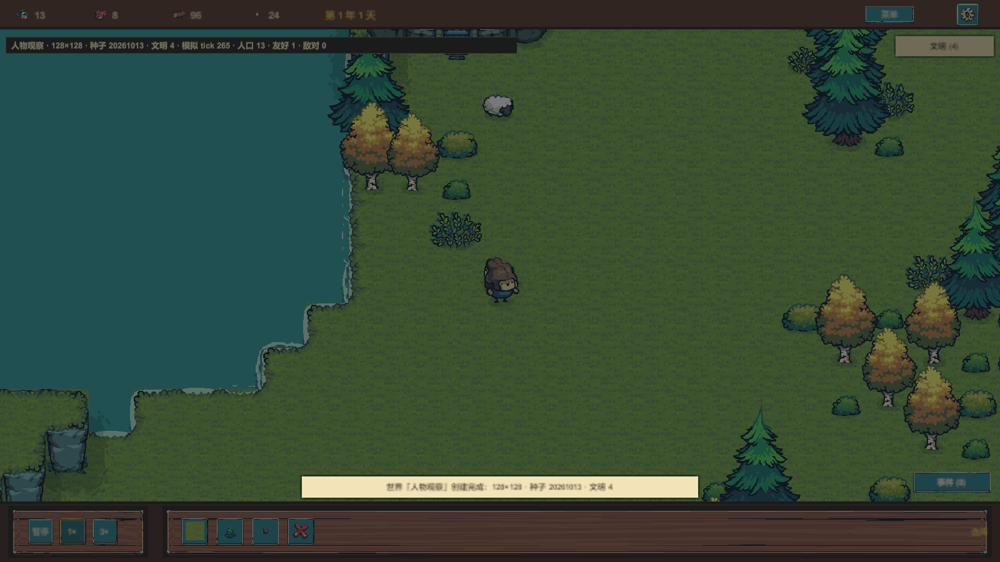

# D-068 最终视觉与可玩性收口（r3）

- 批次：**full-game-quality-2026-10-17-r3**
- 引擎：Unity **6000.6.5f1**（Unity CLI **1.0.0-beta.12**，本轮未升级）
- 系统：Windows 11 家庭版 10.0.26200
- 被测主仓库：WorldSandboxPrototype，HEAD **f85fbe346118e6ee5a6a0e2a33f76f8e653d4259** + **未提交工作树**
- 证据仓库：WorldSandboxPrototype-visual-evidence（本批次只新增本目录）

> 结论边界：本批次达到 **G4 测试通过（局部）** 与 **G5 真实运行截图证据** 的素材级证据，
> **没有**达到 G9 用户验收；也不把全量 PlayMode 的 72 个失败写成通过。主仓库未提交、未推送。

## 1. 关键画面

本地直接打开以下 PNG 即可，均为 PlayMode 真实相机 + 真实 uGUI 合成，不是 AI 图、不是静态拼图。






## 2. 本轮真正修掉的问题

1. **纸面 UI 统一**：纸面 9-slice 自带的内部粉色投影线造成“耳朵/脏边”；槽位 0 改为实心 `UITheme.Paper` + 深色描边 + 阴影，主菜单/新世界/读档/设置/暂停/加载/确认/Toast 统一。
2. **UI 层级**：MainCanvas 1000、ScreenFlowRoot 1100；确认框/Toast 在覆盖层根被隐藏后由 `EnsureOverlayRoot` 重新激活，解决“状态存在但画面看不到”。
3. **新世界 1280×720**：面板 880×760、摘要卡 150 高/17px，四行摘要不再裁切；英文默认名走 `d067.new.defaultName`，显示 “New World”。
4. **文明面板**：500×700；标签列 210，英文 Births/Deaths 单行；页脚与外交行在 1280 下不重叠。
5. **人物/建筑**：房屋选址跳过已有生物格，修复“人物卡进建筑/不可通行格”；`D068CharacterRenderTests` 3/3。
6. **HUD 人口**：世界人口取快照真实存活总数；无文明数据的旧快照回退第一聚落，修复 `HudEqualsSnapshot` 食物 0 的回归。
7. **事件日志**：原木纹高频底 + 13px 暗字 + 120 高面板，导致字被木纹干扰且第 4 条被裁；改为**实心深木底 + 奶油字 + 1px 深描边**，行高 26、面板 300/320，8 条容量完整可见。截图 07 是修复后实拍。
8. **测试隔离**：`LifeAnimCoverageTests` TearDown 清空 `EntityViewManager`，消除已销毁 provider 污染后续用例的 NRE。
9. **默认世界名常量化**：UI 不再出现中文字面量，通过 `NoHardcodedChineseInUIScripts`。

## 3. 截图清单（26 张）

### 1600×900（21 张）

| 文件 | 内容 |
| --- | --- |
| r3-01-main-menu-zh.png | 主菜单中文 |
| r3-02-new-world-zh.png | 新世界表单中文，摘要四行完整 |
| r3-03-world-with-life-zh.png | 真实世界与生命，HUD 人口 16 |
| r3-04-civ-panel-zh.png | 文明详情中文：人口 4/12、资源、外交 |
| r3-05-pause-menu-zh.png | 暂停菜单 |
| r3-06-settings-zh.png | 设置页 |
| r3-07-event-log-zh.png | 事件日志修复后：8 条完整、无裁切 |
| r3-08-characters-closeup-zh.png | 人物/建筑/树/羊特写 |
| r3-09-characters-after-200ticks-zh.png | 200 tick 后仍可见 |
| r3-10-loaded-world-zh.png | 读档后世界 |
| r3-11-civ-panel-en.png | 文明详情英文 |
| r3-12-pause-menu-en.png | 暂停英文 |
| r3-13-settings-en.png | 设置英文 |
| r3-14-main-menu-en.png | 主菜单英文 |
| r3-17-terrain-seed-20261013.png | 地形种子 20261013 |
| r3-17-terrain-seed-20261014.png | 地形种子 20261014 |
| r3-17-terrain-seed-20261015.png | 地形种子 20261015 |
| r3-18-coast-cliff-zh.png | 海岸/崖壁/高地 |
| r3-19-confirm-zh.png | 退出确认框（可见） |
| r3-20-save-toast-zh.png | 保存 Toast（可见） |
| r3-21-load-game-zh.png | 读档页 |

### 1280×720（5 张）

| 文件 | 内容 |
| --- | --- |
| r3-15-main-menu-1280x720.png | 主菜单 |
| r3-16-civ-panel-1280x720.png | 文明面板 |
| r3-22-pause-menu-1280x720.png | 暂停 |
| r3-23-settings-1280x720.png | 设置 |
| r3-24-new-world-1280x720.png | 新世界，英文默认名 New World |

## 4. 测试原始输出

完整文件与命令见 `tests/README.md`，原始 XML 未编辑。

| 套件 | 结果 |
| --- | --- |
| 全量 EditMode | **417/417 通过** |
| D068FinalCaptureTests | **4/4 通过，26/26 PNG** |
| D068CharacterRenderTests | **3/3 通过** |
| D068FinalUiTests | **3/3 通过** |
| D067 真实流程（设置 D067_SHOT_DIR） | **8/11**，逐条见 `tests/README.md` |
| 全量 PlayMode | **109 总：37 通过 / 72 失败**，逐条分类见 `tests/playmode-full-failures.md` |
| 全量中的 D068 功能用例 | 自动存档 **6/6**（600 tick 一次、暂停停、读档基线、世界切换、失败反馈、v1 兼容）；面板/事件 **5/5**；人口一致性 **1/1** |

> 三个旧 `D068_Capture_*` 在全量中失败仅因未设置 `D068_SHOT_DIR`；定向 `D068FinalCaptureTests` 设置目录后 **4/4、26 PNG**，见上表。

D-067 的失败不是“截图全挂”：
- `D067_CaptureEnglishScreens` 写完 8 张英文截图后，按旧控件名 `Btn_Done` 找不到关闭按钮（当前是本地化标签 `Btn_完成`）；
- `R3_EnglishFlow...` 单独运行 **1/1 通过**，全量批次是场景未就绪的顺序问题；
- `D067_FullFlow` 的 640×480 `ScreenCapture` 在 batchmode 不落盘，是 D-067 §8 已登记的环境阻塞。

全量 PlayMode 的 72 个失败中：33 个历史 CaptureWriteGuard 拒绝、9 个截图目录环境前置、28 个旧用例前置装配为空、1 个测试顺序隔离、1 个 F_BuildingsFx 旧场景状态。**没有把任何失败改成通过。**

## 5. 仍未收口（如实登记）

1. 坡面色族规范/实现冲突（DECISIONS §2.24 / D-068 §2.6）仍待裁定；代码仍取落脚层。
2. 规范 §D.3 阴影 1:1 与实现 ×1.6 的表述差异仍待裁定。
3. 1 行宽台面属 D-061 噪声高程设计，未加宽度规则。
4. `WaterEdgeOverlay(162)` / `Stairs(190)` 仍为无 SetTile 的死层。
5. 全量 PlayMode 仍有 72 失败（分类见上）；旧套件 `F_BuildingsFx` 期望 4 建筑但为 0，**待逐条单独复核，不计入通过**。
6. D-067 同批 8/11；把顺序相关的 R3 单独跑为 9/11，剩余为选择器漂移与 batchmode ScreenCapture。
7. 英文文明面板中，世界生成的文明专名仍为中文（如“晨曦王国”），UI 标签已全英文；专名本地化未在本轮实现。
8. 主仓库 **未提交、未推送**；证据仓库只新增本批次。

## 6. 复现

PowerShell，工作目录为主仓库：

```powershell
# 全量 EditMode
unity test . --mode EditMode --output Logs/d068-r3-editmode.xml

# D-068 最终截图（唯一写入本批次截图的命令）
$env:D068_FINAL_SHOT_DIR='D:\data\UnityProjects\WorldSandboxPrototype-visual-evidence\evidence\full-game-quality-2026-10-17-r3\screenshots'
unity test . --mode PlayMode --filter WorldSandbox.Tests.PlayMode.D068FinalCaptureTests --output Logs/d068-r3-capture-playmode.xml

# 全量 PlayMode（不设截图目录，故意保留环境前置失败）
unity test . --mode PlayMode --output Logs/d068-r3-playmode-all.xml
```

`unity test` 全部通过时也可能返回 shell exit code 1/2；以 XML 的 result 属性为准。

## 7. 证据完整性

- `FILELIST.md`：本批次全部文件清单。
- `SHA256SUMS.txt`：除自身外全部文件 SHA-256；可用 `Get-FileHash` 或 `sha256sum -c` 复核。
- `tests/`：原始 XML/日志与失败分类，未编辑测试结果。
- `ENVIRONMENT.md`：环境、命令、边界。
- 历史批次 r2 与本批次互不覆盖；本批次目录在提交前不存在于远端。

## 8. 状态声明

- 设计完成：D-068 相关实施文档已更新（主仓库 `docs/impl/D-068-文明详情与剩余交付.md` §7）。
- 代码已实现：是，主仓库工作树。
- 测试通过：**局部**（417 EditMode、D068 4/4、3/3、3/3）；全量 PlayMode 未通过，已分类。
- 游戏实际运行通过：**仅就本批 26 张真实截图所覆盖的流程**成立，不覆盖全部旧套件。
- 用户验收通过：**未达到**，交 ChatGPT/用户独立验收。
